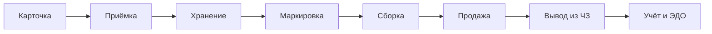
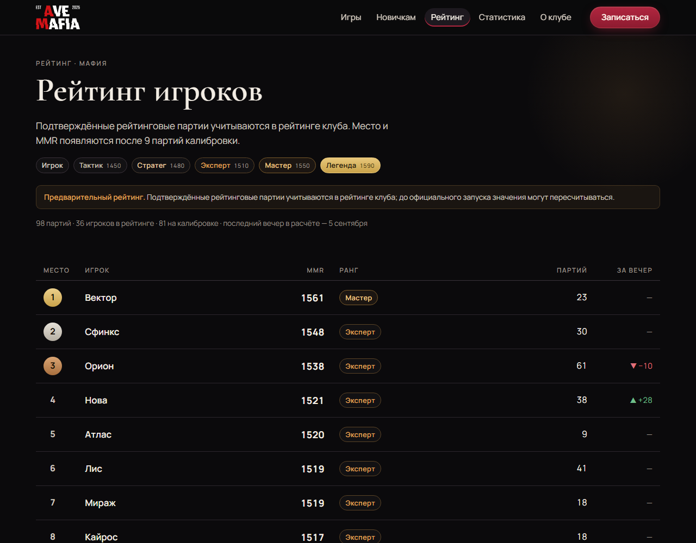

# Владислав Аверков

**Системы управления товаром для e-commerce: от карточки до вывода из оборота**

Основатель и CEO ООО «Авендекс» · Python-бэкенд · интеграции с маркетплейсами · «Честный знак» · склад и учёт · аналитика

---

Разработал и внедрил в действующей торговой компании собственную систему: заменил 1С, автоматизировал маркировку «Честный знак», склад и сборку заказов для магазинов на Ozon, Wildberries и Яндекс Маркете. Всё работает в продакшене каждый день.

|  10 | 10 000+ | 65+ | ≈ 9 000 | ×2,7 |
|:---:|:---:|:---:|:---:|:---:|
| магазинов: 4 Ozon, 4 Wildberries, 2 Яндекс Маркет | карточек товаров под управлением | контрагентов переведено из 1С | коммитов в основном репозитории | рост чистых заказов после ценовой модели |

## Единая система управления товаром

Один контур вместо набора разрозненных программ: владелец, склад, сборщики и бухгалтерия видят одно и то же состояние товара.

| Направление | Что сделано |
|---|---|
| **Уход от 1С** | Приобретение, списание, сборка и разборка склада. Поступления на счёт и кассовые ордера. Реализации, счета-фактуры, акты сверки, долги. Перенос остатков и сальдо 65+ контрагентов. Отмена проведения с обратными движениями. Подготовка обмена УПД через ЭДО с подписью по МЧД |
| **Автоматизация процессов** | Боты для склада и менеджеров (MAX, Telegram). Лист подбора, пересортированный по местам хранения. Фоновые задачи по расписанию. Реестр инициатив со сроком и проверкой итога |
| **«Честный знак»** | Автоматический снимок по будням и сбор документов на вывод кодов. Контроль доли выведенных кодов по каждой площадке. Документы до 5 000 кодов. Расхождения блокируются и попадают в журнал |
| **Склад и сборка** | Стандарт адресного хранения для нескольких складов. Единая страница «Сборка» вместо четырёх отдельных. Один экран скана заказов Wildberries, Ozon и Маркета. Панель «Не собрано» и автозакрытие сборок |
| **Прослеживаемость** | Связка карточка → место → сборка → код → заказ → выбытие. Журнал каждой операции с автором и временем. Права по личным учётным записям. Единая книга остатков с синхронизацией на площадки |

## Аналитика: цены на данных

Собственная модель юнит-экономики считает реальную маржу по каждому товару: комиссии, логистика, возвраты, соинвест. На ней пересмотрены цены на Ozon: на непродающих позициях снижение в среднем на 25 %.

Сравнение 28 дней до и 31 день после, без отменённых заказов:

| Показатель | Изменение |
|---|--:|
| Чистые заказы | **+170 %** |
| Выручка | **+144 %** |
| Прибыль по модели | **+35 %** |
| Доля отмен | **33 % → 24 %** |

Маржа сознательно снижена с 18 до 10 %, рост объёма с запасом это перекрыл. Почти весь прирост дали товары, которые раньше не продавались.

## Собственное дело: AVE MAFIA

Клуб игры в мафию: регулярные вечера, корпоративы, сертификаты. Основал в 2025 году и сам построил вокруг него продукт: публичный сайт, рейтинг игроков, учёт партий, Telegram-бот записи и управленческую панель.

- **Рейтинг MMR** с рангами и калибровкой, написан с нуля
- **Правка и аннулирование партий** с историей изменений
- **Независимый аудит** и автотесты на критичные сценарии
- **Разбор рукописных листов** ведущего в данные: роли, голосования, итоги
- **Управленческая панель**: заполняемость, удержание игроков, рефералы, каналы привлечения

 Публичный рейтинг (на скриншоте вымышленные ники). Сайт avemafia.ru скоро будет доступен.

## Стек

| | |
|---|---|
| **Backend** | Python, Flask, FastAPI, aiogram, SQLite, PostgreSQL |
| **Интеграции** | Ozon Seller API, Wildberries API, Яндекс Маркет, Честный знак, Контур.Диадок |
| **Данные и ML** | pandas, lightgbm, scikit-learn, юнит-экономика |
| **Frontend** | TypeScript, Next.js, React, Tailwind, Recharts |
| **Инфраструктура** | Linux, Docker, systemd, Caddy, cron |
| **Процессы** | git и ревью, pytest, стенд → релиз, журнал смен |

## Как я работаю

- **Сначала стенд, потом одна выкатка.** Боевой контур не трогается каждой мелочью, откат готов до релиза.
- **Замок падает в запрет.** Если проверка не может ответить, операция блокируется и оставляет след в журнале.
- **Считаю по факту, а не по формуле.** Маржа по отгруженным, деньги со знаком, производные величины из данных.
- **Результат проверяется цифрами.** Каждое изменение получает срок проверки и критерий успеха.

## Связаться

Интеграции с маркетплейсами, маркировка, склад, учёт и аналитика. Напишите, что нужно автоматизировать.

**averkov2001@gmail.com**
